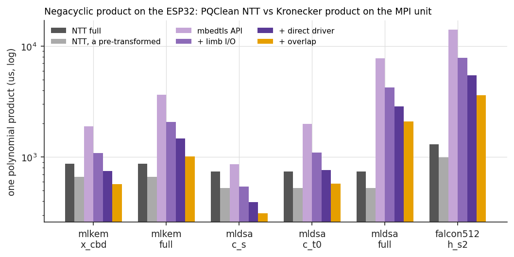
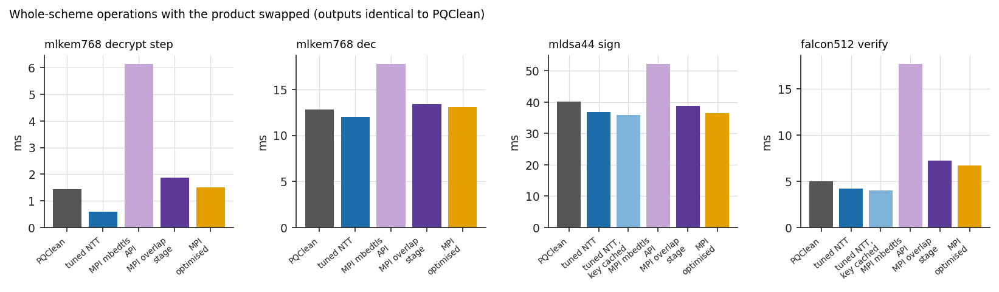
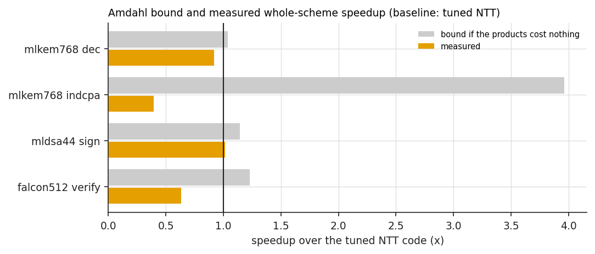
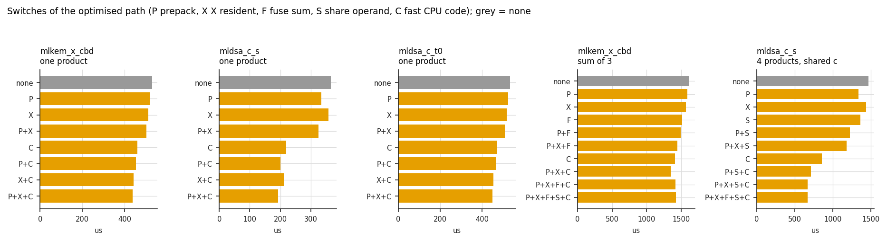
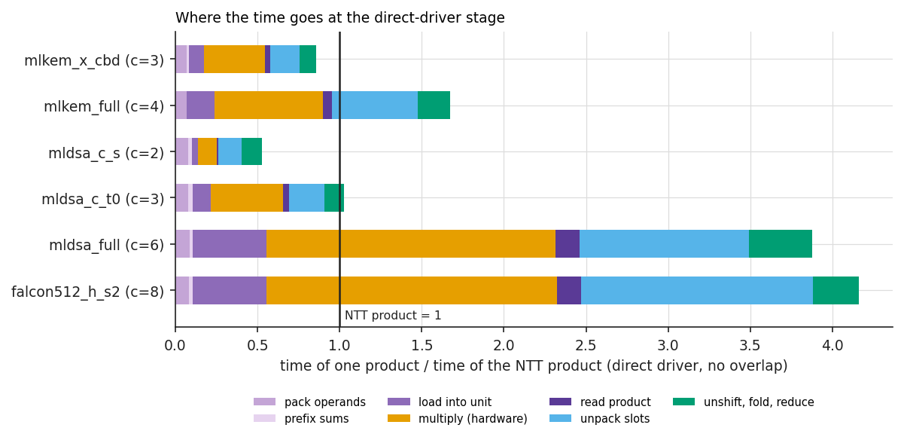

# Polynomial products for ML-KEM, ML-DSA and Falcon on the ESP32 RSA/MPI unit

The ESP32 has a hardware big-integer multiplier (the "RSA/MPI" unit, operands up to 2048 bits). In an earlier team course project (Cryptonite) we ran neural-network layers on it as
big-integer multiplies (Kronecker packing) and got a 3.9x speed-up from three changes to the data path around the multiply, while still ending up slower than a plain CPU kernel.
This repo tries the same idea on post-quantum cryptography: pack a negacyclic polynomial product into integer multiplies on the unit, apply those three optimisations, then go further
(prepacked keys, unrolled pack/unpack code, fused sums, shared operands), and compare against the PQClean clean-C NTT and against an NTT I tuned for this core.
All numbers are from one ESP32-D0WD-V3 at 240 MHz.

"Faster than the unoptimised version" can mean two things, so both are reported:

* **(a) against the naive packed product** (public mbedtls API, per-call copies): the optimised path is 4.0x to 4.6x faster per polynomial product, 4.1x for the ML-KEM decrypt step, and 1.4x to 2.7x
  for whole operations (ML-KEM decapsulation 1.36x, ML-DSA signing 1.43x, Falcon verification 2.65x).
* **(b) against an NTT**: mostly no gain, and a loss against the tuned NTT in most cases. Per product, the packed path beats the PQClean NTT for ML-KEM u x s (0.50x of its time), ML-DSA c x s (0.26x) and
  c x t0 (0.61x), and loses for the full-width products. Against my tuned NTT it wins only for ML-DSA c x s (0.51x of the time). At whole-operation level it ties or loses: ML-KEM-768 decapsulation takes 1.02x
  the time of PQClean and 1.09x the time of the tuned NTT, ML-DSA-44 signing 0.91x and 0.99x, Falcon-512 verification 1.38x and 1.58x. The ceiling set by how much of each operation
  is polynomial products (Amdahl table below) is 1.1x to 1.4x against PQClean, and the measured results sit on it.

## Which data each table comes from

* `results/raw/`: the final run (`./run_all.sh`, 2026-10-28, 14 CSVs) plus `e2e_extra.csv` (ML-KEM with the fused sum switched off, run afterwards on the same firmware with `host/run_extra.py`). Every table and figure below is made from these.
* `results/raw_v1/`: the first delivery's run (the four stages only, no tuned NTT, no optimised path). Kept for the record; its numbers agree with the stage columns here within about 1%.
* `results/raw_first_pass/`, `results/raw_interim/`: earlier partial runs, not used for any number.

## Results

### One polynomial product (microseconds; every output checked bit for bit)

"Key side transformed" = the NTT baseline with the second (fixed) operand already in the NTT domain, the situation of a key or matrix; the optimised path likewise has that operand prepacked.
"mbedtls API" is the naive packed product, "+ overlap" the last stage of the first delivery, "optimised" the new path at its best chunking (measured over all feasible ones).

<!-- begin:polymul_latency -->
| case | PQClean NTT full (us) | PQClean NTT, key side transformed (us) | tuned NTT full (us) | tuned NTT, key side transformed (us) | mbedtls API (us) | + overlap (us) | optimised (us) | mbedtls API / optimised | optimised / PQClean full | optimised / PQClean pre | optimised / tuned full | optimised / tuned pre | mismatches |
|---|---|---|---|---|---|---|---|---|---|---|---|---|---|
| mlkem_x_cbd | 871.77 | 664.11 | 303.77 | 230.50 | 1902.32 | 561.94 | 437.76 | 4.35 | 0.50 | 0.66 | 1.44 | 1.90 | 0 |
| mlkem_full | 871.80 | 663.92 | 303.86 | 230.48 | 3638.81 | 1009.11 | 910.52 | 4.00 | 1.04 | 1.37 | 3.00 | 3.95 | 0 |
| mldsa_c_s | 738.28 | 525.61 | 376.23 | 285.08 | 878.28 | 307.03 | 193.24 | 4.55 | 0.26 | 0.37 | 0.51 | 0.68 | 0 |
| mldsa_c_t0 | 738.24 | 525.50 | 376.25 | 285.07 | 1996.28 | 567.33 | 450.51 | 4.43 | 0.61 | 0.86 | 1.20 | 1.58 | 0 |
| mldsa_full | 738.30 | 525.54 | 376.27 | 285.07 | 7809.63 | 2139.03 | 1908.80 | 4.09 | 2.59 | 3.63 | 5.07 | 6.70 | 0 |
| falcon512_s2_h | 1304.43 | 987.13 | 776.74 | 578.02 | 14226.55 | 3660.87 | 3245.90 | 4.38 | 2.49 | 3.29 | 4.18 | 5.62 | 0 |
<!-- end:polymul_latency -->

Operand ranges, slot widths and multiplies per product (host prototype, identical to what the firmware computes):

<!-- begin:packing_plan -->
| case | n | q | a range | b range | chunks per operand | coeffs per chunk | slot bits | padded operand bits | MPI multiplies |
|---|---|---|---|---|---|---|---|---|---|
| mlkem_x_cbd | 256 | 3329 | [0,3328] | [-2,2] | 3 | 86 | 21 | 2048 | 9 |
| mlkem_full | 256 | 3329 | [0,3328] | [0,3328] | 4 | 64 | 30 | 2048 | 16 |
| mldsa_c_s | 256 | 8380417 | [-1,1] | [-2,2] | 2 | 128 | 11 | 1536 | 4 |
| mldsa_c_t0 | 256 | 8380417 | [-1,1] | [-4095,4096] | 3 | 86 | 21 | 2048 | 9 |
| mldsa_full | 256 | 8380417 | [-131071,131072] | [0,8380416] | 6 | 43 | 47 | 2048 | 36 |
| falcon512_s2_h | 512 | 12289 | [-2047,2047] | [0,12288] | 8 | 64 | 32 | 2048 | 64 |
<!-- end:packing_plan -->



### Whole-scheme operations (milliseconds; only the product steps are swapped, everything else is PQClean; outputs identical to PQClean in every run)

<!-- begin:e2e_compact -->
| operation | PQClean (ms) | PQClean NTT copy (ms) | tuned NTT (ms) | tuned NTT, key cached (ms) | MPI mbedtls API (ms) | MPI overlap stage (ms) | MPI optimised (ms) | mbedtls API / optimised | optimised / NTT copy | optimised / tuned NTT | optimised / tuned, key cached | outputs identical |
|---|---|---|---|---|---|---|---|---|---|---|---|---|
| ML-KEM-768 decapsulation | 12.83 | 12.83 | 12.02 |  | 17.82 | 13.41 | 13.11 | 1.36 | 1.02 | 1.09 |  | yes |
| ML-KEM-768 decrypt step | 1.43 | 1.43 | 0.60 |  | 6.15 | 1.87 | 1.51 | 4.06 | 1.06 | 2.53 |  | yes |
| ML-DSA-44 signing | 40.11 | 40.13 | 36.94 | 35.84 | 52.27 | 38.81 | 36.45 | 1.43 | 0.91 | 0.99 | 1.02 | yes |
| Falcon-512 verification | 4.98 | 4.84 | 4.24 | 4.03 | 17.74 | 7.23 | 6.70 | 2.65 | 1.38 | 1.58 | 1.66 | yes |
<!-- end:e2e_compact -->

* "PQClean NTT copy" is my copy of the PQClean function (the wrapper costs nothing for ML-KEM and ML-DSA; the Falcon copy is 3% faster than the shipped function, cause not chased).
* The tuned-NTT variants replace the same steps as the MPI variants: ML-KEM decrypt product; ML-DSA c x s1, c x s2, c x t0 and the NTTs they need; Falcon h x s2. The A x y products of ML-DSA signing stay on PQClean's NTT in every variant.
  "key cached" means the transform of the secret key (ML-DSA) or public key (Falcon) is done once outside the timing instead of in every call (PQClean redoes it); the MPI path always has its key prepacked outside the timing.
* The MPI "optimised" column uses all switches except the fused sum for ML-KEM (switch set 19), since the fused sum turned out slower, see below. For ML-DSA and Falcon it is all switches (31).
* ML-DSA signing depends on the rejection loop; the four messages and seeds are fixed, so every variant does the same 64 passes over 32 signatures.
* Memory cost of the prepacked key material (`results/tables/e2e.md`, column "prepacked key"): ML-KEM secret 4.6 KB (counts both the fused and unfused layouts, so about twice what one layout needs), ML-DSA secret 18.5 KB, Falcon public key 6.2 KB.



### Amdahl: what is possible at whole-operation level

Share = time of the replaceable product steps inside the baseline (measured in place with the cycle counter), speedup = measured time of those steps in the baseline over their time in the MPI variant, bound = Amdahl's
1 / ((1 - share) + share / speedup); the last column is the measured whole-operation ratio. The bound at the measured speedup reproduces the measured ratio to within 1 to 2%, which is a consistency check on the timing of the steps.

<!-- begin:amdahl -->
| operation | baseline | baseline total (ms) | share of time in the product steps | product steps: optimised MPI speedup (x) | bound if the products cost nothing (x) | bound at the measured product speedup (x) | measured whole-scheme speedup (x) |
|---|---|---|---|---|---|---|---|
| mlkem768 dec | copy of it, PQClean NTT | 12.83 | 0.10 | 0.89 | 1.11 | 0.99 | 0.98 |
| mlkem768 dec | tuned NTT | 12.02 | 0.04 | 0.31 | 1.04 | 0.92 | 0.92 |
| mlkem768 indcpa | copy of it, PQClean NTT | 1.43 | 0.91 | 0.95 | 11.09 | 0.96 | 0.94 |
| mlkem768 indcpa | tuned NTT | 0.60 | 0.75 | 0.33 | 3.96 | 0.40 | 0.40 |
| mldsa44 sign | copy of it, PQClean NTT | 40.13 | 0.19 | 1.98 | 1.24 | 1.11 | 1.10 |
| mldsa44 sign | tuned NTT | 36.94 | 0.12 | 1.16 | 1.14 | 1.02 | 1.01 |
| mldsa44 sign | tuned NTT, key transform cached | 35.84 | 0.10 | 0.88 | 1.11 | 0.99 | 0.98 |
| falcon512 verify | copy of it, PQClean NTT | 4.84 | 0.28 | 0.42 | 1.40 | 0.72 | 0.72 |
| falcon512 verify | tuned NTT | 4.24 | 0.19 | 0.24 | 1.23 | 0.63 | 0.63 |
| falcon512 verify | tuned NTT, key transform cached | 4.03 | 0.14 | 0.18 | 1.17 | 0.60 | 0.60 |
<!-- end:amdahl -->

So even with free products, ML-KEM-768 decapsulation could only get 1.11x faster than PQClean (the re-encryption inside decapsulation multiplies by the public matrix in the NTT domain and is not replaced), ML-DSA-44 signing 1.24x, Falcon-512 verification 1.40x.
Against the tuned NTT the ceilings are 1.04x, 1.14x and 1.23x. The decrypt step on its own is 91% products in PQClean (ceiling 11x), but it is 11% of decapsulation.



### The switches, alone and combined (microseconds; `results/tables/ablation.md` has every combination)

<!-- begin:ablation_summary -->
| kind | case | none (us) | prepack alone (us) | X resident alone (us) | fuse sum alone (us) | share operand alone (us) | fast CPU code alone (us) | fastest combination | fastest (us) | none / fastest |
|---|---|---|---|---|---|---|---|---|---|---|
| one product | mlkem_x_cbd | 529.32 | 519.71 | 512.74 |  |  | 460.14 | prepack + X resident + fast CPU code | 438.82 | 1.21 |
| one product | mlkem_full | 950.37 | 941.82 | 916.93 |  |  | 951.99 | prepack + X resident | 909.02 | 1.05 |
| one product | mldsa_c_s | 366.31 | 333.83 | 358.01 |  |  | 219.63 | prepack + X resident + fast CPU code | 193.18 | 1.90 |
| one product | mldsa_c_t0 | 534.99 | 525.36 | 517.75 |  |  | 472.06 | prepack + X resident + fast CPU code | 450.42 | 1.19 |
| one product | mldsa_full | 1995.81 | 1994.20 | 1908.94 |  |  | 1995.77 | prepack + X resident | 1908.73 | 1.05 |
| one product | falcon512_s2_h | 3403.91 | 3385.48 | 3245.95 |  |  | 3404.91 | prepack + X resident | 3236.06 | 1.05 |
| sum of 3 products (ML-KEM decrypt shape) | mlkem_x_cbd | 1621.00 | 1591.21 | 1570.40 | 1514.29 |  | 1412.56 | prepack + X resident + fast CPU code | 1348.91 | 1.20 |
| 4 products, common operand | mldsa_c_s | 1466.31 | 1335.83 | 1433.03 |  | 1359.73 | 854.23 | prepack + X resident + share operand + fast CPU code | 664.86 | 2.21 |
| 4 products, common operand | mldsa_c_t0 | 2136.21 | 2099.34 | 2082.87 |  | 1995.87 | 1890.18 | prepack + X resident + fuse sum + share operand + fast CPU code | 1648.07 | 1.30 |
<!-- end:ablation_summary -->



What each one does and what it bought (one product unless stated):

* **Fast CPU code** (`kron_fast.cpp`: pack, unpack and the unshift/reduce written so that the shifts are immediates, 32 slots per unrolled group, one pass instead of two): the largest single gain where the slot width fits 32 bits and accumulators fit 32 bits
  (ML-DSA c x s 1.67x, ML-KEM u x s 1.15x, c x t0 1.13x). No effect for the three wide cases (16, 36, 64 multiplies), which use the generic 64-bit path.
* **Prepack** of the fixed operand (and its prefix sums): 0% to 10%. **X resident** (keep X in the unit across the products that share it): 2% to 5%.
* **Shared operand** (ML-DSA signing: c is packed once and stays loaded for the vector of four products c x s1 / s2 / t0): 1.08x alone; with prepack, X resident and fast code, 2.21x for c x s and 1.30x for c x t0.
* **Fused sum** (a sum of products is added as packed integers before one unpack): 1.07x alone for three ML-KEM products, but **slower in combination** with the fast CPU code (1421 us against 1349 us without it). The extra word-wise add after every multiply and the wider slots cost more than the unpack and unshift it saves. Negative result; the ML-KEM variants use the set without it.
* **No clear of the Z block** (skip zeroing the lower half of the unit's Z block between products): works in the host mock but **gives wrong products on the unit** (18 of 24 checks fail in every case, `mismatches` column in `ablation.md`). It is rejected, not part of any "all switches" set, and the times in its rows are not results.
  This is the one place the software stand-in for the multiplier differed from the hardware; the unit adds into Z, so the lower half has to be zero.

### Where the time goes, and how close the optimised path is to the unit alone

The unit-only time (load, start, wait, read for every multiply of the plan, no CPU work at all) is a floor for any single-core driver of the unit.

<!-- begin:unit_floor -->
| case | chunks | multiplies | unit only, X reloaded (us) | unit only, X resident (us) | optimised (us) | optimised / unit only (X resident) |
|---|---|---|---|---|---|---|
| mlkem_x_cbd | 3 | 9 | 407.26 | 392.94 | 437.76 | 1.11 |
| mlkem_full | 4 | 16 | 723.95 | 694.58 | 910.52 | 1.31 |
| mldsa_c_s | 3 | 9 | 128.99 | 121.64 | 193.24 | 1.59 |
| mldsa_c_t0 | 3 | 9 | 407.18 | 392.99 | 450.51 | 1.15 |
| mldsa_full | 6 | 36 | 1632.98 | 1561.79 | 1908.80 | 1.22 |
| falcon512_s2_h | 8 | 64 | 2905.62 | 2767.84 | 3245.90 | 1.17 |
<!-- end:unit_floor -->

The optimised path is within 1.11x to 1.31x of this floor for the ML-KEM, ML-DSA c x t0, full-width and Falcon products, and 1.59x for ML-DSA c x s (193 us against 122 us, where the CPU work is a larger part of a short product).
Consequences:

* A second core doing the packing and unpacking while the first drives the unit could at best close that gap. It is not built. For ML-KEM u x s it would take 438 us to 393 us at most, and the unit-only floor of 393 us
  is above the tuned NTT product (304 us full, 231 us with the key side transformed), so no amount of CPU-side work or core count can make the packed ML-KEM product beat the tuned NTT.
  The same holds for c x t0 and the full-width cases. For ML-DSA c x s the floor (122 us) is below the tuned NTT (376 / 285 us), so a second core could matter there (193 us now, 122 us at best).
* The NTT baselines in this repo are single-core. I did not build a two-core NTT.

Direct-driver stage breakdown before the switches (`results/tables/breakdown.md`), from the first-delivery code path: for the narrow cases the hardware multiply is 39% to 45% of a product, load and read 13% to 15%, CPU work 39% to 47%.



### Multiplier alone (`results/tables/multiplier.md`)

<!-- begin:multiplier -->
| bits | mbedtls_us | direct_us | load_us | compute_us | read_us | mbedtls_exact | direct_exact |
|---|---|---|---|---|---|---|---|
| 512 | 25.45 | 5.92 | 2.10 | 2.96 | 0.86 | 1 | 1 |
| 1024 | 40.80 | 15.04 | 3.86 | 9.65 | 1.53 | 1 | 1 |
| 1536 | 60.26 | 28.75 | 5.82 | 20.66 | 2.27 | 1 | 1 |
| 2048 | 84.04 | 46.74 | 7.67 | 36.07 | 3.00 | 1 | 1 |
| 2560 | 487.93 | n/a | n/a | n/a | n/a | 1 | n/a |
| 3072 | 397.08 | n/a | n/a | n/a | n/a | 1 | n/a |
<!-- end:multiplier -->

A 2048 x 2048-bit multiply is 36 us of compute plus 8 us to load and 3 us to read: 47.5 us through the direct driver against 84 us through mbedtls. Above 2048 bits the unit cannot be used
(the Z block holds the 4096-bit product, `MAX_WORDS = 64` in `firmware/src/mpi_hw.h`); mbedtls then takes 486 us at 2560 bits and 385 us at 3072 bits, so it no longer runs one hardware multiply
(I did not look at what it does instead). I did not try to write past the Z block, so the 2048-bit cap is established from the register layout and from that timing, not by forcing a larger operand into the unit.

### Plans that were considered and not built (`results/tables/plan_variants.md`; computed, not timed)

<!-- begin:plan_variants -->
| case | now: slot bits | now: multiplies | signed slots: slot bits | signed slots: multiplies | Karatsuba: slot bits | Karatsuba: multiplies |
|---|---|---|---|---|---|---|
| mlkem_x_cbd | 21 | 9 | 20 | 9 | 22 | 12 |
| mlkem_full | 30 | 16 | 29 | 16 | 32 | 12 |
| mldsa_c_s | 11 | 4 | 10 | 4 | 13 | 3 |
| mldsa_c_t0 | 21 | 9 | 20 | 9 | 22 | 12 |
| mldsa_full | 47 | 36 | 46 | 36 | 48 | 48 |
| falcon512_s2_h | 32 | 64 | 31 | 64 | 34 | 75 |
<!-- end:plan_variants -->

Centred operands with signed slots save one bit of slot width and no multiply in any case. One Karatsuba level over the chunk grid reduces the multiply count only for `mlkem_full` (16 to 12) and `mldsa_c_s` (4 to 3),
and raises it for the cases that matter (ML-KEM u x s 9 to 12, ML-DSA y x A 36 to 48, Falcon 64 to 75), because the wider slots force smaller chunks. For ML-DSA c x s three 2048-bit multiplies (3 x 47.5 us from the table above) cost more than the present
nine 1024-bit ones. Neither was implemented.

## The tuned NTT

`firmware/src/ntt_tuned.c`: the same transforms as PQClean (7-layer incomplete NTT for q = 3329, complete negacyclic NTT for q = 8380417 and q = 12289), written for the LX6: signed 32-bit Montgomery arithmetic with R = 2^32
(the core has `mull` and `mulsh`), coefficients in int32 so there is no sign extension, one reduction per butterfly and none between layers, the inverse transform reduced once at the end (and once half way for q = 8380417 to stay inside 32 bits),
hot functions in IRAM. Its results are checked bit for bit against the schoolbook product on the host and on the board (`check_cpu.csv`), and the whole-scheme variants give PQClean's outputs.

| transform (microseconds) | PQClean forward / inverse | tuned forward / inverse |
|---|---|---|
| ML-KEM (n = 256, q = 3329) | 208 / 329 | 73 / 135 |
| ML-DSA (n = 256, q = 8380417) | 213 / 245 | 91 / 176 |
| Falcon (n = 512, q = 12289) | 471 / 502 | 199 / 344 |

(`results/tables/ntt_parts.md` has the pointwise parts too.) The tuned NTT product is 1.7x to 2.9x faster than PQClean's clean C on this core. Unverified: how much of that gap is the IRAM placement. PQClean's code runs from flash through the cache
and I did not move it to IRAM or the tuned code to flash, so part of the gap may not be the arithmetic. This is my own tuning, not an external reference implementation, and a better one may exist.

## What was done

**Packing** (`host/kron_proto.py` proves it in Python; `firmware/src/kron.c` is the C version). Two polynomials a, b of n coefficients are shifted to be non-negative (a' = a + oa, b' = b + ob when a range has negative values), cut into c chunks of m coefficients,
and each chunk is written into an integer with one coefficient per w-bit slot. One integer multiply of two chunks gives, in slot k, the sum of a'_i b'_j over i + j = k. The slot width is the smallest w for
which terms * m * max(a') * max(b') < 2^w, so no slot can carry into the next. The chunk products are added into a linear product of 2n - 1 slots, the shifts are removed
(P_k = P'_k - ob * window sum of a - oa * window sum of b - terms * oa * ob * count; the window sums come from prefix sums), x^n = -1 is folded in and the result is reduced mod q.
The script checks every feasible plan against a schoolbook negacyclic product with random and extreme operands, and that w - 1 bits breaks the worst case.

**Stages of the first delivery** (`firmware/src/polymul_hw.cpp`), as in the RSA project:

| stage | what changes |
|---|---|
| mbedtls API | each chunk is copied in with `mbedtls_mpi_read_binary_le`, multiplied with `mbedtls_mpi_mul_mpi`, copied out with `write_binary_le` |
| + limb I/O | chunks are packed straight into the limbs of the `mbedtls_mpi` structs and the product is unpacked straight from them |
| + direct driver | `mpi_hw.h`: operands stored into the unit's memory blocks, start, wait, product read back with plain loads (the unit is acquired once per benchmark run; 6 us for acquire plus release, not in any time) |
| + overlap | the CPU packs the next chunks and unpacks the previous product while the unit runs |

Per-stage times of this run: `results/tables/polymul_stages.md`.

**Optimised path** (`firmware/src/polymul_fast.cpp`, `kron_fast.cpp`, `fast_hooks.cpp`): overlap as above plus the switches in the ablation. Packing is done once per operand in every stage.

**Scheme code** (`firmware/src/schemes_*.c`): PQClean's clean-C sources are used unchanged; the variants are copies of three functions with the product steps replaceable (ML-KEM-768 decapsulation: the decryption product s^T u, secret key converted to coefficient form once per key;
ML-DSA-44 signing: c x s1, c x s2, c x t0; Falcon-512 verification: h x s2). Not swapped: ML-KEM key generation and encapsulation, ML-DSA verification (they multiply by matrices defined in the NTT domain), Falcon signing (floating-point FFT).

## Findings

1. **The optimised path is 4.0x to 4.6x faster than the naive packed product** per product in every case (the first delivery's three stages gave 2.9x to 3.9x; the rest is prepacking, X resident, the faster CPU code and the shared operand).
2. **The packed product beats PQClean's NTT product for small-coefficient operands**: ML-KEM u x s 438 us against 872 us (664 us with the key side transformed), ML-DSA c x s 193 us against 738 / 526 us, c x t0 451 us against 738 / 526 us.
   It loses for ML-KEM full x full (911 us), ML-DSA y x A (1909 us) and Falcon (3246 us).
3. **A tuned NTT beats the packed product in five of six cases.** ML-KEM u x s: 304 us (231 us key side transformed) against 438 us, and the unit-only floor of the nine multiplies (393 us) is already above that, so this is not a matter of further tuning the CPU side.
   Only ML-DSA c x s (193 us against 376 / 285 us) stays faster on the unit, and only because it needs nine multiplies of 1024 bits.
4. **Whole operations: no meaningful gain.** Against PQClean: ML-KEM decapsulation 1.02x the time, ML-DSA signing 0.91x (9% faster), Falcon verification 1.38x. Against the tuned NTT: 1.09x, 0.99x (a tie; 1.02x if the tuned variant also caches the key transform), 1.58x.
   ML-KEM decrypt step alone: 1.51 ms against 1.43 ms (PQClean) and 0.60 ms (tuned NTT). PQClean amortises one inverse NTT over the three products of a decrypt and keeps the secret transformed; the unit sees three independent jobs.
5. **ML-DSA signing is the one operation where the packed path is ahead of PQClean** (9%), because it does not transform s1, s2, t0 and c, and shares the packed challenge across 12 products. A tuned NTT with the key transform cached is as fast (35.8 ms against 36.5 ms).
6. **Negative results among the switches**: the fused sum (slower combined with fast code), the skipped Z clear (wrong results on the unit), prepack and X resident (small), second core and Karatsuba (not worth building, see above).
7. **The fewest-multiplies plan is the best plan** in every case; the optimised path's best chunking differs from the earlier stages only for ML-DSA c x s (3 chunks, nine small multiplies, instead of 2).

## Reproduce

```
# host: packing proof, plan variants, and all host tests (C code with a software multiplier standing in for the unit, including the optimised engine and the scheme hooks)
python3 host/kron_proto.py && python3 host/plan_variants.py
./tests/run_host_tests.sh

# board: copy the repo to the machine the ESP32 is plugged into, build, flash, measure (holds the board lock); then the follow-up and the copy back
rsync -a --exclude .git --exclude .pio --exclude results -e "ssh -o BatchMode=yes -o HostKeyAlias=pi.local" ./ ankushachwani@100.87.8.122:~/pqc_opt/
ssh -o BatchMode=yes -o HostKeyAlias=pi.local ankushachwani@100.87.8.122 'cd ~/pqc_opt && OUT=results/raw_run ./run_all.sh'          # about 35 minutes
ssh -o BatchMode=yes -o HostKeyAlias=pi.local ankushachwani@100.87.8.122 'cd ~/pqc_opt && python3 host/run_extra.py results/raw_run'  # ML-KEM, fused sum off
rsync -a -e "ssh -o BatchMode=yes -o HostKeyAlias=pi.local" ankushachwani@100.87.8.122:~/pqc_opt/results/raw_run/ results/raw/

# tables and figures from the raw CSVs
python3 analysis/make_table.py && python3 analysis/plot.py && python3 analysis/embed_tables.py
```

Needs numpy, pandas, matplotlib (host), pyserial (on the Pi), PlatformIO (Arduino-ESP32 core with ESP-IDF 4.4.7, `firmware/platformio.ini`). Serial commands are documented at the top of `firmware/src/main.cpp`.

## Checks that were run

* Host (`./tests/run_host_tests.sh`): packing and all plans against the schoolbook product (6 cases, every feasible chunking, random and extreme operands); fused sums of 2 to 4 products; fast pack/unpack/unshift against the generic code; tuned NTT; ML-KEM decapsulation
  (60 ciphertexts, valid and corrupted), ML-DSA signatures (byte for byte), Falcon verification (valid and tampered) for PQClean, the NTT copy, the tuned NTT and the optimised path under every switch combination; the optimised engine under every switch combination
  (46,080 checks) with a software multiplier.
* Board, `results/raw/check.csv`: 13,984 checks (46 operand pairs for each of 76 case-and-chunking plans at each of four stages), 0 mismatches. `check_cpu.csv`: both NTT implementations, 1,824 checks, 0 mismatches.
  `fast_sweep.csv`: 1,824 checks over the same 76 plans for the optimised path, 0 mismatches. `fast_ablation.csv`: 2,160 checks, the only mismatches are the 12 rows with the skipped Z clear (18 of 24 each). `e2e.csv` and `e2e_extra.csv`: all 44 runs produce PQClean's output.
* The host prototype's plans (slot width, operand size, multiplies) are the ones the firmware computed (76 of 76, asserted in `analysis/make_table.py`).

## Limits of the numbers, and what is unverified

* One board, one key and four messages per scheme. Repetition counts 26 to 400 for products (relative standard deviation at most 1.5%), 288 or more for the switch ablations.
* The tuned NTT is my own, and its IRAM placement versus PQClean's flash placement is uncontrolled (see above). Whole-scheme "tuned" variants replace only the steps the MPI variants replace.
* The NTT baselines are single-core; a two-core NTT and a two-core packed path were not built.
* The direct driver reads the product with plain loads, valid while only one core uses the unit; mbedtls and the driver are never used at the same time.
* The best plan per case was chosen from the same sweep that is reported; the plans differ by much more than the run-to-run spread.
* The ML-KEM secret key is converted to coefficient form once per key and not timed. For all three schemes the one-off key packing is not in any time (memory cost given above).
* The sibling PQClean benchmark repo's decapsulation and ML-DSA verification timings agreed with this repo's PQClean rows within 1% when checked for the first delivery; not re-checked.
* No side-channel or constant-time analysis was done.

## Not measured

Energy and power. The board has no current sensor, so there are no energy numbers and no claims about energy. Also not measured: code size of the variants, other parameter sets (ML-KEM-512/1024, ML-DSA-65/87, Falcon-1024), other chips (the other ESP32 variants have a different RSA peripheral).

## Layout

```
host/kron_proto.py, plan_variants.py   packing math and plan variants in Python
host/                                  board.py (serial), run_bench.py (full run), run_extra.py, cmd.py
firmware/src/kron.*, kron_fast.*       packing, unpacking, shift removal (generic and fast)
firmware/src/mpi_hw.h                  direct driver for the unit (from Cryptonite)
firmware/src/polymul_hw.cpp            the four stages;  polymul_fast.*, fast_hooks.*  the optimised path
firmware/src/ntt_tuned.*, cpu_tuned.c  tuned NTT
firmware/src/schemes_*.c               NTT baselines and the whole-scheme variants on top of PQClean
firmware/src/main.cpp                  serial benchmark protocol
tests/                                 host tests (with tests/mock_mpi_hw.h standing in for the unit)
analysis/                              tables, figures, README table embedding
vendor/pqclean/                        PQClean clean-C sources (see vendor/README.md)
results/raw, tables, figures           final run;   results/raw_v1 first delivery's run
```

## Credits

* PQClean (https://github.com/PQClean/PQClean) for the clean-C ML-KEM, ML-DSA and Falcon implementations and `fips202`; licence files are kept in `vendor/pqclean`. Those implementations derive from the Kyber, Dilithium and Falcon reference code.
* mbedtls (as shipped with ESP-IDF 4.4.7 in the Arduino-ESP32 core) for the baseline multiply path.
* Cryptonite, the earlier team course project on neural-network inference on the same unit: `firmware/src/mpi_hw.h` is the register driver from there, and the first three optimisations are the ones studied there.
